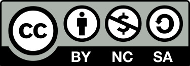

# What is this repository?
This repository offers a guidance for lecturers and students who want to explore the analytic code journey of the exploration of natural language data, the challenges of cleaning and processing text data, the topic of implementing appropriate text representations (in the form of e.g., BoWs or TF-IDFs and more modern self-trained and pre-trained word embedding approaches). In addition, users of this repository will be introduced to the world of language modelling. Initial implementation examples of baseline models from the fields of recursive neural networks (RNNs) and transformer-based learning are provided in addition to renowned machine learning models. Through an analytical and competitive comparison of these machine learning and deep learning techniques, lecturers and students can apply these approaches to individualised natural language-based use case data, adapt and even extend the code units. The coding examples are part of the course 'AI in Action, which is offered as a compulsory elective for Master's students at the University of Hohenheim in Stuttgart, Germany.

# What can I use it for?
This repository can be used to solve various Natural Language Processing tasks on real-world business data. Depending on the data set and distribution of the data, a selective choice of processing, representation or modeling approaches can be considered. Various techniques are provided for each of these milestones which can be compared with each other as part of an analytical comparison.

# What do I need in order to use it?
This program has been written in Python by using Jupyter Notebook. Please download Jupyter Notebook (e.g. via the Anaconda distribution) together with your individual text  datasets to use the code units. Do not forget to adapt the first LOCs in sense of importing your own individual text dataset.

# Copyright / License
This work is licensed under a Creative Commons Attribution 4.0 International License (CC BY-NC-SA 4.0).

 
As such:

### You are free to:
* Share — copy and redistribute the material in any medium or format
* Adapt — remix, transform, and build upon the material
* The licensor cannot revoke these freedoms as long as you follow the license terms.

### Under the following terms:
* Attribution — You must give appropriate credit , provide a link to the license, and indicate if changes were made . You may do so in any reasonable manner, but not in any way that suggests the licensor endorses you or your use.
* NonCommercial — You may not use the material for commercial purposes .
* ShareAlike — If you remix, transform, or build upon the material, you must distribute your contributions under the same license as the original.

# Authors, Citation
Muhammed-Fatih Kaya {0000-0002-9646-2829}, University of Hohenheim, Germany

Cite as:

*Introduction into Natural Language Processing and Modeling Methods by Muhammed-Fatih Kaya, licensed under
[CC-BY-NC-SA](https://creativecommons.org/licenses/by-nc-sa/4.0/legalcode.txt),
via https://github.com/AI-for-Business/AIinAction_HOH_ABBA*

# DOI - Code
[Generate DOI]

# Contact / About us
* You can find all of our repositories [here](https://github.com/orgs/AI-for-Business/repositories).
* You can find the homepage of the project ABBA: **A**I for **B**usiness | **B**usiness for **A**I
[here](https://abba-project.de/).
* You can contact the authors by sending us an [email](mailto:abba-services@fim-rc.de).
